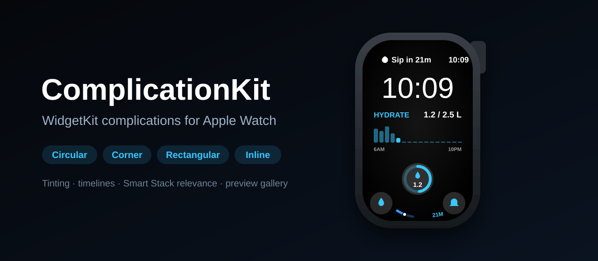
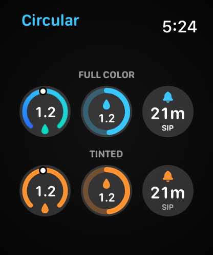
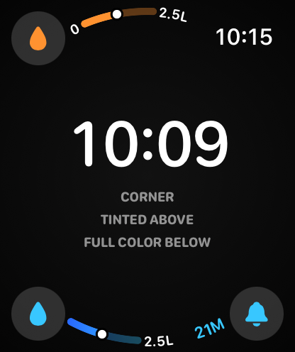
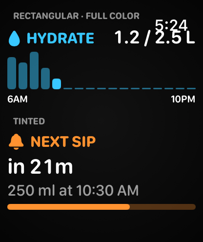
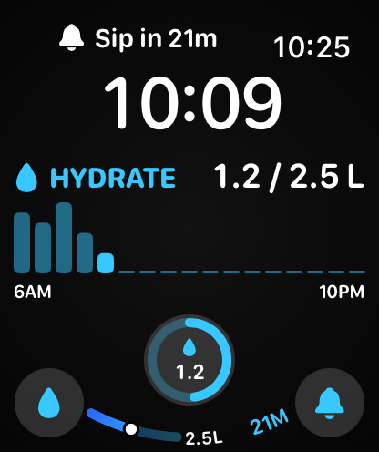

<p align="center">
  
</p>

<p align="center">
  <a href="https://github.com/halilozel1903/ComplicationKit/actions/workflows/ci.yml"></a>
  
  
  
  
  <a href="LICENSE"></a>
</p>

**ComplicationKit** is a set of SwiftUI views and helpers for WidgetKit complications on Apple Watch: ready-made templates for **every accessory family** (circular, corner, rectangular and inline), **tinting** that follows `widgetRenderingMode` and `widgetAccentable`, a `ComplicationFamilyView` that picks the right template for `widgetFamily`, **timeline helpers** for countdowns, hourly refreshes and Smart Stack relevance, and a **preview gallery** that draws your complications at their real point size on a mock watch face, in full color and tinted. The logic behind them (clamping, gauge ranges, compact numbers and durations, timeline generation with an injected clock) is plain Swift and fully unit tested.

```swift
ComplicationFamilyView {
    CircularRingComplication(progress: 0.48, valueText: "1.2", symbolName: "drop.fill")
} corner: {
    CornerGaugeComplication(value: 1.2, in: 0...2.5, symbolName: "drop.fill", trailingText: "2.5L")
} rectangular: {
    RectangularChartComplication(title: "Hydrate", valueText: "1.2 / 2.5 L", values: hourly)
} inline: {
    InlineComplication(symbolName: "drop.fill", text: "1.2 of 2.5 L", compactText: "1.2 L")
}
```

## Screenshots

Captured from the example app's complication gallery on an Apple Watch simulator by CI. The complications are drawn at their real size for 46mm and 49mm watches. All numbers are made up.

| Circular | Corner | Rectangular | Watch face |
| :---: | :---: | :---: | :---: |
|  |  |  |  |

## Features

- **Circular templates**: `CircularGaugeComplication` (an open 270° gauge with a gradient, a marker and a symbol or label in the gap), `CircularRingComplication` (a closed progress ring with a symbol over the value) and `CircularStackComplication` (a symbol or caption, a big value and a unit).
- **Corner templates**: `CornerGaugeComplication` and `CornerTextComplication`. Inside a widget the gauge or text goes into `widgetLabel`, which watchOS curves along the bezel; in previews the views draw the same curved label themselves.
- **Rectangular templates**: `RectangularTextComplication` (a tinted header, a headline, a detail line and an optional progress bar) and `RectangularChartComplication` (a header with the current value and a bar chart with a highlighted bar and axis captions).
- **Inline**: `InlineComplication`, a symbol and a line of text with a shorter fallback when the long one does not fit.
- **`ComplicationFamilyView`**: one view for a widget's entry view that switches on `widgetFamily`; `ComplicationFamily.widgetFamilies` is the list for `supportedFamilies`.
- **Tinting**: every template reads `widgetRenderingMode` through `ComplicationStyleReader` and marks its colored parts `widgetAccentable`, so tinted faces paint the accent group in their tint and the rest in white. `complicationRenderingMode(_:tint:)` simulates a tinted face in previews.
- **Timeline helpers**: `ComplicationTimeline.countdownEntries` changes exactly on the minute (or any interval), `Timeline.countdown` adds the right reload policy, `Timeline.hourly` refreshes at the top of every hour, and `CountdownEntry` is a ready-made `TimelineEntry`.
- **Smart Stack relevance**: `CountdownEntry` rises in relevance over the last 15 minutes, `ComplicationRelevance.goalScore` ranks goals by how far they are, and on watchOS `SmartStackRelevance` feeds `RelevantIntentManager` for App Intent widgets.
- **Preview gallery**: `ComplicationGallery`, `WatchFacePreview`, `MockWatchFace` and `ComplicationPreview` draw complications at the sizes from Apple's Human Interface Guidelines (`ComplicationMetrics` for 40, 41, 44 and 45/46/49mm), in full color and tinted.
- **Tested logic**: `ComplicationRange`, `ComplicationValue`, `CompactNumber`, `CompactTime`, `ComplicationTimeline` with an injected `ComplicationClock`, `ComplicationRelevance`, `ComplicationInk`, `ComplicationChart`, `CornerLabelLayout` and `WatchFaceLayout`, with Swift Testing. NaN, infinity, negative values and empty ranges are handled everywhere, and numbers are locale independent.
- **Swift 6 strict concurrency**, zero dependencies. Built for watchOS 10; also compiles on iOS 17 (Lock Screen widgets use the same circular, rectangular and inline views) and macOS 14, so previews and `swift test` run on a Mac. Watch-only APIs are behind `#if os(watchOS)`.

## Installation

### Swift Package Manager

In Xcode choose **File › Add Package Dependencies…** and enter:

```
https://github.com/halilozel1903/ComplicationKit
```

Or add it to `Package.swift`:

```swift
dependencies: [
    .package(url: "https://github.com/halilozel1903/ComplicationKit", from: "1.0.0")
]
```

Add the `ComplicationKit` library to your widget extension target (and to your app if you want the preview gallery there).

## Usage

### A widget with every family

```swift
import ComplicationKit
import SwiftUI
import WidgetKit

struct WaterEntry: TimelineEntry {
    let date: Date
    let liters: Double
    let hourly: [Double]

    var relevance: TimelineEntryRelevance? {
        .complication(score: ComplicationRelevance.goalScore(progress: liters / 2.5))
    }
}

struct WaterView: View {
    let entry: WaterEntry

    var body: some View {
        let text = CompactNumber.string(entry.liters)          // "1.2"
        ComplicationFamilyView {
            CircularRingComplication(progress: entry.liters / 2.5, valueText: text, symbolName: "drop.fill", tint: .cyan)
        } corner: {
            CornerGaugeComplication(value: entry.liters, in: 0...2.5, symbolName: "drop.fill", trailingText: "2.5L", colors: [.blue, .cyan])
        } rectangular: {
            RectangularChartComplication(title: "Water", symbolName: "drop.fill", valueText: "\(text) L", values: entry.hourly, tint: .cyan)
        } inline: {
            InlineComplication(symbolName: "drop.fill", text: "\(text) of 2.5 L", compactText: "\(text) L")
        }
        .containerBackground(for: .widget) { Color.clear }
    }
}

struct WaterWidget: Widget {
    var body: some WidgetConfiguration {
        StaticConfiguration(kind: "Water", provider: WaterProvider()) { entry in
            WaterView(entry: entry)
        }
        .supportedFamilies(ComplicationFamily.widgetFamilies)
    }
}
```

### Templates

```swift
CircularGaugeComplication(value: 72, in: 0...100, symbolName: "battery.75percent", colors: [.red, .yellow, .green])
CircularRingComplication(progress: 0.6, valueText: "1.2", symbolName: "drop.fill", tint: .cyan)
CircularStackComplication(top: .symbol("thermometer.medium"), value: "21°", bottom: "H 24")

CornerGaugeComplication(value: 0.62, symbolName: "bolt.fill", leadingText: "0", trailingText: "100")
CornerTextComplication(symbolName: "figure.walk", label: "6,480", tint: .green)

RectangularTextComplication(title: "Standup", symbolName: "calendar", headline: "10:30 – 10:45", detail: "Room 4", tint: .red)
RectangularChartComplication(title: "Steps", valueText: "6,480", values: steps, leadingAxisText: "6AM", trailingAxisText: "NOW")

InlineComplication(symbolName: "sun.max.fill", text: "Sunny, 21°", compactText: "21°")
```

Keep corner labels short: a corner has room for about a dozen characters, and the two bottom corners share the bottom of the face.

### Tinting

The templates already mark their colored parts as accentable. For your own complication views, read the style and paint each part by its role:

```swift
ComplicationStyleReader { style in
    VStack {
        Image(systemName: "drop.fill")
            .foregroundStyle(style.color(.cyan))                     // the face tint on tinted faces
            .complicationAccentable()                                // widgetAccentable on watchOS and iOS
        Text("1.2 L")
            .foregroundStyle(style.color(.white, role: .primary))    // white
        Text("of 2.5")
            .foregroundStyle(style.color(.gray, role: .secondary))   // translucent white
    }
}
```

### Timelines

```swift
// A countdown that changes exactly on the minute and never reloads once it is over.
func getTimeline(in context: Context, completion: @escaping (Timeline<CountdownEntry>) -> Void) {
    completion(.countdown(to: timer.endDate, every: 60))
}

// An entry now and at the top of each of the next 12 hours, then a new timeline.
func getTimeline(in context: Context, completion: @escaping (Timeline<WaterEntry>) -> Void) {
    completion(.hourly(count: 12) { date in WaterEntry(date: date, liters: store.liters(at: date), hourly: store.hourly(at: date)) })
}
```

`CompactTime.shortest(entry.remaining)` gives "21m", `CompactTime.abbreviated` "1h 5m" and `CompactTime.clock` "12:34". Every generator takes a `ComplicationClock`, so tests and previews can freeze time:

```swift
let entries = ComplicationTimeline.countdownEntries(to: ready, every: 60, clock: .fixed(now))
// now 9:41:30, ready 9:45 -> 9:41:30, 9:42, 9:43, 9:44, 9:45
```

On watchOS, widgets configured with an App Intent can also tell the Smart Stack when they matter:

```swift
try await SmartStackRelevance.update(intent, widgetKind: "Water", intervals: [nextDrinkWindow])
```

### Previews

```swift
#Preview {
    ComplicationGallery {
        WaterView(entry: .preview)
    }
}

#Preview("Corner, tinted") {
    MockWatchFace {
        ComplicationPreview(.corner, renderingMode: .accented, tint: .orange) {
            WaterView(entry: .preview)
        }
    }
}
```

`WatchFacePreview` places one complication of each family on a face; give it one view for every slot or a different view per `WatchFaceSlot`. Corner labels are drawn by `MockWatchFace`, so put corner previews inside one.

## How it works

Each template reads the rendering mode once through `ComplicationStyleReader` and resolves every part to a role: accent (gauges, rings, symbols), primary text or secondary text. In full color the parts keep their colors; on a tinted face the accent parts are wrapped in `widgetAccentable` and the system paints them in the face tint, while text becomes white or translucent white. Preview views set an override in the environment and a stand-in tint, so the same code shows the tinted look outside a watch face. Corner complications put their gauge or text in `widgetLabel` inside a widget; in previews they publish their position as an anchor preference, and `MockWatchFace` draws the curved label along a circle around the face center with a `Canvas`, one glyph at a time, using `CornerLabelLayout` to place the arc. Timelines are pure functions of a clock: countdown boundaries are computed back from the end date, so entries land exactly on whole minutes.

## Example app

The `Example` folder contains a standalone Apple Watch app, **Complications**, with the gallery: vertically paged mock watch faces showing every family at its real size, in full color and tinted. It embeds **HydrateWidgets**, a real WidgetKit extension for a fictional water tracker with two widgets (water today and a countdown to the next glass) in every accessory family, so you can add them to a watch face in the simulator. It uses [XcodeGen](https://github.com/yonaskolb/XcodeGen) so no project file has to live in the repo:

```bash
brew install xcodegen
cd Example && xcodegen generate
open ComplicationDemo.xcodeproj
```

Launch it with `-screenshot circular`, `corner`, `rectangular` or `face` to open the scenes used for the screenshots above.

## Requirements

- Xcode 26 or later (Swift 6.2 toolchain)
- watchOS 10+ (iOS 17+ and macOS 14+ are supported too)

## Contributing

Issues and pull requests are welcome. Please run `swift test` before opening a PR.

## License

ComplicationKit is available under the MIT license. See [LICENSE](LICENSE).
